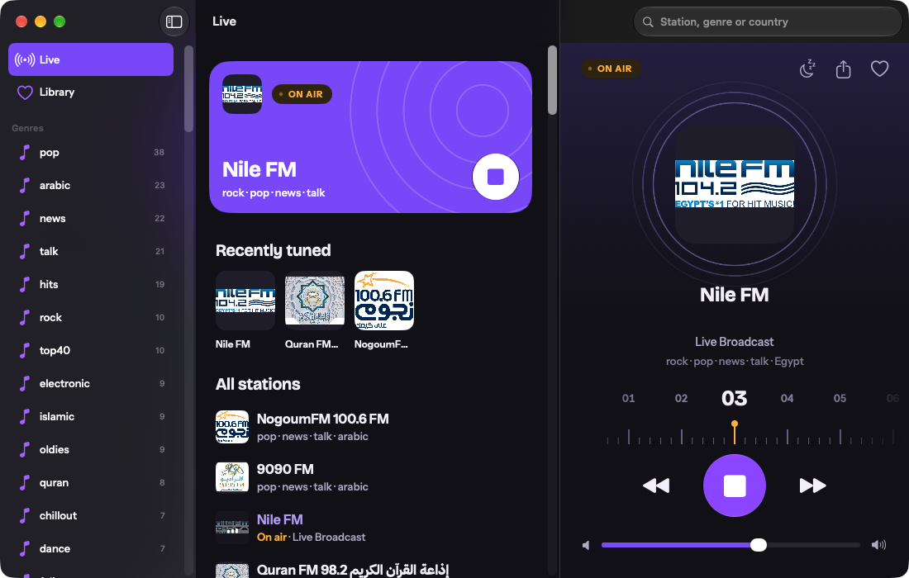

# EgyGrooves

Live internet radio built around Egypt and the Arab world, for macOS and Android.
Pick a station by genre or country, or turn the tuner dial like an old radio and land on whatever comes next.

## Download

**[Get the latest release →](https://github.com/AmrEsam0/egygrooves-app/releases/latest)**

| Platform | File on the release page |
|---|---|
| macOS 14+ (Apple Silicon) | `EgyGrooves_<version>_aarch64.dmg` |
| Android | [Get it on Google Play](https://play.google.com/store/apps/details?id=com.labyrinthcode.egygrooves) |

### First launch

The Mac app isn't signed yet, so macOS asks once: open EgyGrooves once, then System Settings → Privacy & Security → **Open Anyway**. Or run `xattr -dr com.apple.quarantine /Applications/EgyGrooves.app`

## Features

| Feature | What it does |
|---|---|
| Live | A featured station, the ones you tuned recently, and the full station list |
| Browse | Genres (pop, tarab, Quran, jazz, news and more) and countries in the sidebar, with Egypt first |
| Tuner dial | Every station has a channel number. Drag the dial, scroll it, or use the arrow keys to move across stations |
| Search | Matches station name, genre and country as you type |
| Favorites | Tap the heart on any station to keep it in your Library |
| Menu bar radio | A small player in the menu bar: what's on, play/stop, the dial, favorites and recent stations. Close the window and the radio keeps playing |
| Keyboard and media keys | Space plays or stops, ⌘→ and ⌘← change station, ⌘L favorites. Media keys and Control Center work too |
| Track titles | Shows the song or show name when the station sends one |
| Sleep timer | Stops the radio after the time you pick, fading out at the end |
| Arabic and English | Full right-to-left layout in Arabic |
| Themes | Light, dark or follow the system |

## About

EgyGrooves is made by **NullCheck Labs**. Questions or feedback: [nullchecklabs@gmail.com](mailto:nullchecklabs@gmail.com).
